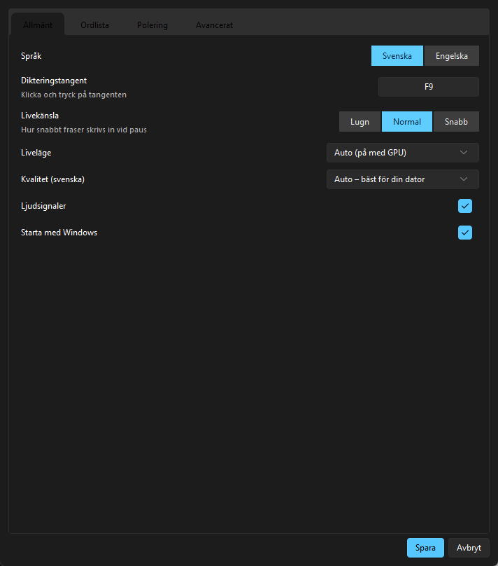
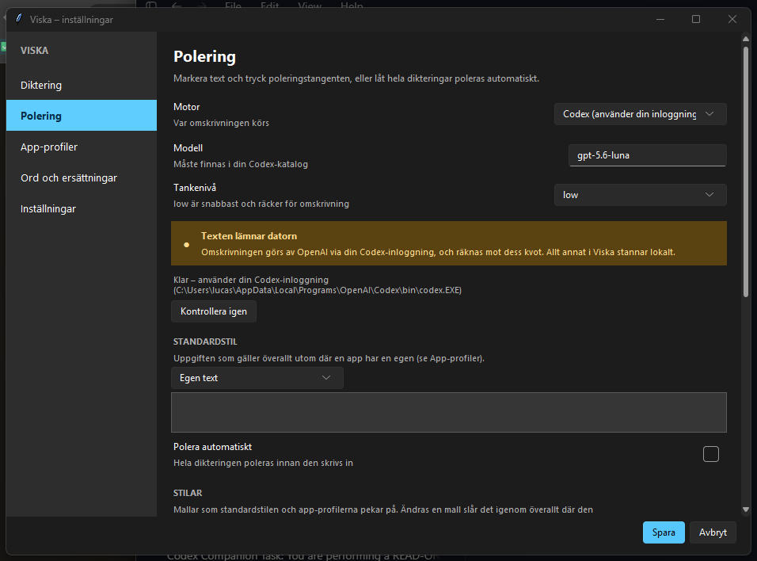
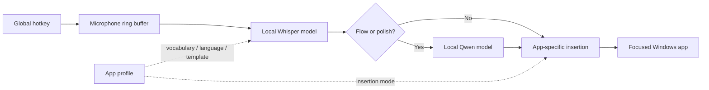

# Viska

<p align="center">
  <strong>Fast, local-first dictation and AI text refinement for Windows.</strong>
</p>

<p align="center">
  <a href="https://github.com/sockulags/viska/releases/latest"></a>
  
  
  
</p>

<p align="center">
  <a href="https://github.com/sockulags/viska/releases/latest"><strong>Download Viska</strong></a>
  ·
  <a href="#quick-start">Quick start</a>
  ·
  <a href="#how-it-works">How it works</a>
</p>

Hold a key, speak, and Viska writes the result at the cursor in almost any Windows app.
It can also rewrite selected text—or polish an entire dictation before inserting it—using
a small language model that runs on your own computer.

Swedish speech recognition uses the Royal Swedish Library's
[KB-Whisper](https://huggingface.co/KBLab/kb-whisper-large) models through
[faster-whisper](https://github.com/SYSTRAN/faster-whisper). English dictation uses a
separate multilingual Whisper model. Audio and text are processed locally.

<p align="center">
  
  
</p>

> The current interface is Swedish. The screenshots are captured from the real v0.4
> settings UI.

## Three ways to work

| Dictate anywhere | See text as you speak | Refine locally |
| --- | --- | --- |
| Hold **F9** to talk, then release. Viska inserts the text into email, chat, Word, browsers, and editors. | On supported GPUs, completed phrases are inserted during natural pauses while the current phrase stays in the status pill. | Select text and press **F8**, or enable Flow mode to polish a complete dictation before insertion. |

## Highlights

- **Push-to-talk or toggle.** Hold the hotkey like a walkie-talkie, or tap once to start
  and once to stop. Bind it to a key, a key combination, or a spare mouse button
  (thumb buttons or the wheel click).
- **The microphone opens only when you dictate.** By default the stream is opened on the
  hotkey and closed again a short while after the last dictation, so the Windows
  microphone indicator is lit only while Viska is actually listening.
- **Replacement rules.** Words the model mishears are always written correctly. Correct the
  last dictation from the tray menu and Viska turns the difference into rules.
- **Application-aware profiles.** Give Outlook, Visual Studio Code, a terminal, or any
  other app its own vocabulary, insertion method, language, and polishing task.
- **Reusable writing templates.** Built-in email, commit-message, chat, formal, and concise
  templates can be edited or replaced with your own.
- **Voice formatting.** Spoken commands such as “new line” and “new paragraph” become
  formatting instead of literal words.
- **Measured, not guessed.** Every dictation is timed — transcription, polishing and
  insertion — and the median is shown in advanced settings and written to the log.
- **Clipboard-aware insertion.** Dictated text is excluded from Windows clipboard history
  and cloud clipboard sync; the previous clipboard content is restored by default.
- **Graceful fallback.** If polishing is unavailable or times out, Viska inserts the raw
  transcript instead of losing the dictation.
- **Portable distribution.** Release builds run without Python, installation, or
  administrator access.

## Quick start

### Portable Windows build

Download the zip from the [latest release](https://github.com/sockulags/viska/releases/latest),
extract it, and run `Viska.exe`. On first launch, Viska detects the available hardware and
offers the appropriate CPU or NVIDIA GPU setup. Models are downloaded on first use.

### Run from source

Requirements: Windows 10/11, Python 3.11 or newer, [uv](https://docs.astral.sh/uv/), and a
microphone.

```bash
git clone https://github.com/sockulags/viska.git
cd viska

# NVIDIA GPU
uv sync --extra gpu

# CPU-only
uv sync

# Verify the selected device and download the speech model
uv run viska --check

# Start Viska
uv run viska
```

An NVIDIA GPU is recommended for sub-second transcription and live mode. CPU mode uses a
smaller model and remains suitable for ordinary push-to-talk dictation. Local text
polishing currently requires the GPU path.

## Everyday controls

| Action | Default | Behaviour |
| --- | --- | --- |
| Dictate while held | Hold **F9** | Records while the key is down, then transcribes and inserts. |
| Longer dictation | Tap **F9**, then tap again | Starts and stops without holding the key. |
| Polish selected text | **F8** | Rewrites the current selection using the app's configured template. |
| Choose a one-off tone | Double-tap **F8** | Opens a small menu without changing saved settings. |
| Switch language | Tray menu | Explicitly switches between Swedish and English; app profiles never change language silently. |
| Correct the last dictation | Tray menu | Edit the text; the changed words become replacement rules for every future dictation. |

The tray menu also exposes recent dictations, microphone selection, settings, update
status, and application exit. History lives only in RAM unless disk persistence is
explicitly enabled.

## How it works



Viska keeps the microphone open by default to avoid clipping the first syllable, but only
retains a rolling buffer of roughly half a second in memory. No recording is saved. Finished
text is inserted either through a protected clipboard flow or by typing Unicode characters
one by one for applications that do not accept paste.

## Local text polishing

The built-in polishing engine runs a quantized Qwen3 4B model through `llama.cpp`. It can:

- remove filler words while preserving meaning
- turn rough speech into an email or chat response
- produce concise imperative commit messages
- apply a reusable global or per-application writing template
- polish each complete dictation automatically in Flow mode

The default model was selected through a local 28-case Swedish evaluation covering noisy
speech, factual preservation, email, commit text, mixed-language input, and long dictation.
The table below reports that project evaluation; it is not an external benchmark.

| Model | Overall | Factual preservation | Median latency |
| --- | ---: | ---: | ---: |
| **Qwen3 4B Instruct Q4** | **8.2 / 10** | **9.2 / 10** | **0.49 s** |
| qwen3.5 9B via Ollama | 7.1 / 10 | 8.2 / 10 | 3.06 s |
| Qwen3 1.7B Q4 | 5.0 / 10 | 8.8 / 10 | 0.27 s |
| EuroLLM 1.7B Q4 | 3.1 / 10 | 7.2 / 10 | 0.19 s |

Read the [evaluation notes and methodology](docs/eval-polering.md). Important text should
still be reviewed before sending; small local models can make language mistakes.

## Polishing without a local GPU

Machines that cannot run a local model at all can send the polishing step to a remote
service. Set `polish_backend` to `http` in advanced settings and point `polish_http_url` at
any OpenAI-compatible `/v1/chat/completions` endpoint. Viska knows nothing about what
answers: an API key, a company gateway, or the small server in
[`tools/polish_server.py`](tools/polish_server.py), which keeps a Codex process warm and
runs each rewrite through it.

```bash
uv run tools/polish_server.py --model gpt-5.6-luna --effort none
```

The server binds to `127.0.0.1:8756`, exposes `/health` and `/v1/chat/completions`, and can
require a bearer token with `--token`. It overrides the user's own Codex configuration —
model, reasoning effort, sandbox and instructions are all set explicitly — so a coding
setup with large developer instructions does not end up prepended to every dictation. The
sandbox is read-only and approvals are denied: the model gets no tools, only text in and
text out. Each request runs in its own ephemeral thread, so one dictation never carries
the previous one as context. Quota exhaustion is reported as HTTP 429 with the provider's
own message, which reaches the Viska log instead of disappearing into a silent fallback.

Run it with `--fake` to test the wiring without spending anything.

**This backend sends the dictated text off the machine.** Everything else in Viska stays
local; this is the one setting that changes that, and it is off by default.

## Privacy model

| Data | Default behaviour |
| --- | --- |
| Microphone | Opened on the hotkey and closed again once you stop dictating (configurable). |
| Audio | Processed in memory and never saved. |
| Speech recognition | Runs locally with faster-whisper. |
| Text polishing | Runs locally with llama.cpp, or optionally against a user-configured Ollama instance or remote endpoint (`polish_backend`). |
| Dictation history | RAM only; disk persistence is opt-in. |
| Clipboard | Previous content is restored; inserted text is marked to avoid Windows history and cloud sync. |
| Network | Used for first-time model downloads and optional GitHub release checks. No telemetry. |

After the required models are present, ordinary dictation and built-in polishing work
offline. Automatic update checks can be disabled in advanced settings.

## Configuration

Most settings are available through the four-tab settings window:

- **General:** language, hotkey, live feel, quality, sounds, and Windows startup
- **Vocabulary:** global terms and application-specific profiles
- **Polishing:** engine, global template, template library, Flow mode, and profile overview
- **Advanced:** model IDs, compute mode, insertion behaviour, privacy controls, and updates

The configuration file is `%APPDATA%\viska\config.json`. It is created on first launch.
Useful defaults include:

| Key | Default | Purpose |
| --- | --- | --- |
| `hotkey` | `f9` | Dictation key or key combination |
| `language` | `sv` | Active speech language |
| `model` | `auto` | Large KB-Whisper on GPU, small on CPU |
| `live` | `auto` | Enabled on GPU, disabled on CPU |
| `inject_mode` | `paste` | Protected clipboard insertion or character-by-character typing |
| `mic_mode` | `on_demand` | Microphone stream open only around dictation (`always`, `closed`) |
| `mic_idle_close_s` | `20` | Seconds of silence before the stream is closed again |
| `replacements` | `{}` | Heard phrase to written text, applied after transcription |
| `history_persist` | `false` | Keep recent dictations in memory only |
| `flow` | `false` | Polish full dictations before insertion |
| `polish_backend` | `builtin` | `builtin`, `ollama`, or `http` (remote endpoint) |

## Tests

The pure logic — configuration migration and atomic writes, replacement rules, the rules
derived from a correction, hotkey parsing, template resolution and the update version
comparison — is covered by a small suite that needs neither a GPU nor a microphone:

```bash
uv run --group dev pytest
```

## Build a portable release

```bash
uv pip install pyinstaller
uv run python build.py          # universal package
uv run python build.py --gpu    # also bundles CUDA libraries for offline GPU setup
```

The universal build can download GPU support later and otherwise falls back to CPU. The
bundled GPU build is intended for machines that must be prepared without network access.

## Diagnostics

```bash
uv run viska --list-devices
uv run viska --transcribe path\to\audio.wav
uv run viska --check
```

The application log is written to `%APPDATA%\viska\viska.log`. See the
[v0.4 release notes](docs/release-notes-v0.4.0.md) for the current feature set.

## Project status

Viska is released and used as a Windows-first Swedish dictation tool. The main limitations
are explicit: the UI is currently Swedish, live transcription benefits substantially from
an NVIDIA GPU, and local polishing requires the GPU setup. CPU dictation remains supported.
